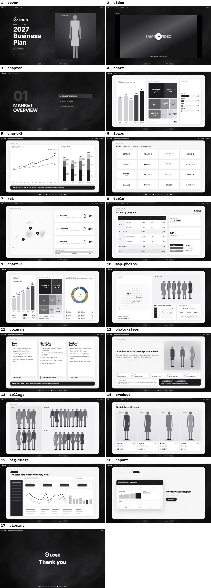
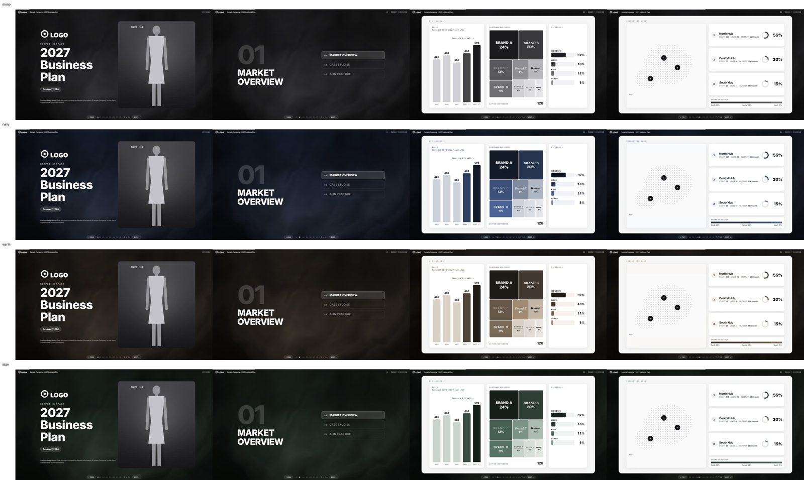

# deck-kit

**원본 자료(PPT·문서·사진)만 주면 Claude Code가 브라우저로 여는 발표 덱을 만들어 주는 키트**입니다. GG AX 팀이 만들고 고쳐 갑니다.

- 슬라이드 넘기기, 발표자 창(스크립트 편집·저장), 움직이는 배경, 차트·표 같은 부품은 키트가 다 갖고 있습니다. 에이전트는 덱마다 내용과 배치만 새로 짭니다.
- 결과물은 폴더 하나(`presentation`)입니다. 인터넷 없이 브라우저로 열고, 공유할 때는 zip으로 보냅니다.
- 디자인 원칙은 실제 덱에서 받은 피드백으로 계속 다듬습니다(`DESIGN.md`).

## 설치 (처음 한 번)

1. GitHub 계정으로 조직 `GG-AX` 초대를 수락합니다(저장소 `GG-AX/deck-kit`, 비공개).
2. PC에 git과 GitHub CLI를 설치하고 로그인합니다(Windows: `winget install Git.Git GitHub.cli`, Mac: `brew install git gh`). 그다음 터미널에서 `gh auth login` → `gh auth setup-git`.
3. 플러그인 설치
   - **VS Code**: 입력창에 `/plug` → **Manage plugins** → **Marketplaces** 탭 → 칸에 `GG-AX/deck-kit` → **Add**. 그다음 **Plugins** 탭에서 `deck-kit`을 찾아 설치합니다.
   - **터미널**(Claude Code CLI): `claude plugin marketplace add GG-AX/deck-kit` → `claude plugin install deck-kit@gg-ax`
4. `/reload-plugins`를 입력한 뒤 **`/deck-kit:update`를 한 번** 실행합니다. 자동 업데이트가 켜집니다(VS Code 화면에는 이 스위치가 없습니다). 그 뒤로는 Claude Code를 시작할 때 새 버전을 받습니다.
5. 예전에 `%USERPROFILE%\.claude\skills\deck-kit`에 복사해 둔 키트가 있으면 지웁니다(두 벌이 겹칩니다).

도구에 필요한 것: Python 3(`pip install pillow websocket-client`, PPT 추출은 `olefile`, 배경 제거는 `numpy scipy rembg`), Microsoft Edge(Mac은 Edge 또는 Chrome), 영상 작업은 ffmpeg(`winget install Gyan.FFmpeg`). 없으면 에이전트가 알려 줍니다.

## 덱 만들기

1. **빈 폴더**를 하나 만들어 VS Code(또는 Claude Desktop 앱의 Code 탭)에서 엽니다. 원본 자료를 그 폴더에 넣거나 대화창에 끌어다 놓습니다.
2. **요청**: "deck-kit으로 ○○ 미팅 발표 자료 만들어줘"처럼 말합니다. `/deck-kit:deck-kit`으로 불러도 됩니다. 테마(아래)나 꼭 지킬 것이 있으면 이때 같이 말합니다.
3. **1차본까지는 묻지 않고 만듭니다.** 에이전트는 모르는 것을 정해서 진행하고 "가정"으로 적어 둡니다. 원본에 빠진 것은 화면에 자리표시로 남깁니다. 넘기기 전에 스스로 전 장을 캡처해 검수합니다.
4. **1차 검수**: 덱 위치, 슬라이드 구성, 가정 목록, 원본 문제 목록, 자체 검수 결과를 한 번에 받습니다. `presentation\Start Presentation.bat`(Windows)를 더블클릭해 보고 의견을 줍니다.
5. **피드백 반영**: 의견을 줄 때마다 에이전트가 먼저 백업(`versions\`)하고, 슬라이드별 수정 계획표를 보여 준 뒤 고칩니다. 메일·메신저로 받은 의견은 그대로 붙여 넣으면 됩니다.
6. **발표·공유**: ← → 이동 · F 전체 화면 · G 전체 보기 · P 발표자 창(스크립트 편집, Ctrl+S 저장) · Enter 영상 재생. 공유는 `presentation` 폴더를 zip으로 보냅니다.

나중에 다시 열 때는 그 폴더를 열고 "session.md 보고 이어서 진행"이라고 하면 됩니다.

## 테마

기본은 모노톤입니다. 요청할 때 `navy`(남색)·`warm`(웜 뉴트럴)·`sage`(세이지) 중 하나를 말하면 배경과 차트 색이 함께 바뀝니다. 에이전트가 먼저 권하지는 않습니다.

## 키트 피드백

덱을 만들다 "키트가 이걸 못 하네", "매번 같은 지적을 받네" 싶은 것은 AX 팀에 알려 주세요. [GitHub Issues](https://github.com/GG-AX/deck-kit/issues)에 남기면 다음 버전에 반영합니다. 덱 하나에만 해당하는 수정은 그 덱 대화에서 에이전트에게 바로 말하면 됩니다.

## 업데이트

자동 업데이트를 켰다면 Claude Code를 켤 때 새 버전을 받습니다. 바로 받으려면 `/deck-kit:update`(또는 Manage plugins → Plugins 탭 `deck-kit`의 🔄)를 실행하고 `/reload-plugins`를 입력합니다. 무엇이 바뀌었는지는 아래 버전 기록에 있습니다.

## 이 폴더 안

| 파일 | 내용 |
| --- | --- |
| `SKILL.md` | 에이전트용 작업 설명서(작업 순서·규칙·부품·도구) |
| `DESIGN.md` | 모든 덱에 공통인 디자인·콘텐츠 원칙 |
| `template/` | 새 덱 폴더의 양식과 견본 덱(부품 사전) |
| `tools/` | 캡처·PPT 추출·점검·백업·이미지 손질 도구 |
| `sample-slides.jpg` · `sample-themes.jpg` | 견본 덱과 테마 미리보기 |

## 키트 버전 기록

키트 = 이 폴더 전체(문서·양식·도구·엔진). 덱을 만들 때 덱의 `session.md`에 맨 아래 버전을 적는다.

| 버전 | 날짜 | 바뀐 점 |
| --- | --- | --- |
| v1.0 | 2026-10-07 | 첫 버전 (엔진 v1.0) |
| v1.1 | 2026-10-08 | 첫 실전 덱 피드백 반영. 작업 순서: 원본만 받고 묻지 않고 만든 뒤 1차 검수로 넘김(가정·원본 문제 목록), 자체 검수, 피드백 반영 전 백업·수정 계획. 디자인 원칙: 원본 배치 재구성 허용, 정보 요소 유지, 로고 면적 맞춤, 사진 크기 통일·가운데 정렬. 도구: `lint.py`·`snapshot.py` 추가, `extract.py`(깨진 그림 건너뜀, PPT 자르기 적용, SVG 그림), `shots.py`(실패한 장 다시 찍기, 덱 저장 시각). 엔진은 그대로 v1.0 |
| v1.2 | 2026-10-08 | 엔진 v1.1: 누적 막대 조각 라벨, 로고 면적 맞춤(B1·B2). 견본 `chart-2`·`logos`에 적용, `sample-slides.jpg` 5·6번 갱신 |
| v1.3 | 2026-10-22 | 덱 3개(Target·Carhartt·Loft) 피드백 1차 반영. 테마 3개(`assets/themes/` navy·warm·sage, 미리보기 `sample-themes.jpg`). DESIGN: 여백·위계, 사진 자르기, 덱 전체 통일, 원본 대조, 지도, 강조색·테마 규칙. SKILL: 자체 검수 목록 보강, `shots.py`는 PowerShell에서, 영상·HTML 원본, DESIGN과 다른 제안 금지, 근거 경로 먼저. 양식 CLAUDE.md 안내문 수정, `lint.py`가 사용법 txt도 검사, 도구가 Mac의 Edge·Chrome도 찾음. 엔진 v1.2 |
| v1.3.1 | 2026-10-22 | Claude Code 플러그인으로 배포(GitHub `Anton-huh/deck-kit`, 마켓플레이스 `gg-ax`). 설치는 위 "설치", 업데이트는 자동 또는 `/deck-kit:update`. 버전은 이제 3자리(`.claude-plugin/plugin.json`의 `version`과 같게) |
| v1.3.2 | 2026-10-22 | 설치 안내를 VS Code 화면(Manage plugins) 기준으로. `/deck-kit:update`가 자동 업데이트도 켠다(VS Code 화면에는 스위치가 없음) |
| v1.3.3 | 2026-10-22 | 저장소를 회사 조직으로 옮김: `GG-AX/deck-kit`. 이미 `Anton-huh/deck-kit`으로 설치했으면 마켓플레이스를 지우고 새 주소로 다시 추가한다 |
| v1.3.4 | 2026-10-26 | 덱 3개(Target RTW·AEO·Nordstrom) 피드백 반영(`docs` 3차). 견본 제목의 인라인 글자 크기를 `.title.l/.m/.s`로, lint가 인라인 제목 크기·옛 엔진(WARN)을 알리고 설치본 줄바꿈 차이로 거짓 ERR를 내지 않음, `used_assets.py`가 백업이 쓰는 파일을 지키게 함. DESIGN: 범주 9개 넘는 차트 구분 팔레트·요청자 지정 색, 사진 높이·머리선 맞추기, 12px 하한, 누끼 밝기. SKILL: 자체 검수(마무리 장·숫자 검산·글자 크기), 피드백 원문 저장, 예전 키트 덱 다루기, zip은 presentation 밖에. 엔진 v1.3 |
| v1.4.0 | 2026-10-26 | 부품 20여 개를 키트로(덱마다 다시 만들던 것): 표 `.tbl`, 숫자 `.stat`·`.kpi`, 제목 줄 `.hd`, 상태 줄 `.tl-row`, 추세 화살표 `svg.trend`, Top 5 줄, 한 줄 비율 막대 `.cr.h`, 도넛 가운데 글자·범례 `.chips`, 사진 벽 `.pnl`+`.wall`, 지도 핀 `.pin`, 그림 위 표시 `.pic`, 로고 줄 `.lgs`, 자리표시 `.todo` 등. 견본에 예시 장 3개(`table`·`chart-3`·`map-photos`, 17장), `sample-slides.jpg` 갱신. SKILL: 견본 = 부품 사전(배치는 따라 하지 않음), 다른 덱 폴더를 보거나 복사하지 않음, session.md에 "키트에 없던 것". README를 팀원용 안내로. 엔진 v1.4 |

## 엔진 버전 기록

엔진 = `template/presentation/assets/engine.js` · `engine.css` (+ `notes_server.ps1`). 바꾸면 `engine.js` 첫 줄의 버전과 이 표를 함께 올린다.

| 버전 | 날짜 | 바뀐 점 |
| --- | --- | --- |
| v1.0 | 2026-10-07 | 첫 버전 — 기존 발표 덱의 엔진을 정리해 분리. 상·하단 바를 엔진이 만듦, 스크립트 저장 키를 덱 폴더별로, 색을 토큰으로, 한글 글꼴(Pretendard), 숫자로 그리는 막대·선 그래프·누적 막대, 부품별 오류 처리, 캡처 모드(`?static`) 고정, 새로고침 뒤 발표자 창 문제 수정 |
| v1.1 | 2026-10-08 | 누적 막대 조각 라벨(`data-stack`의 `"labels":true`), 로고 면적 맞춤(`data-logo-area`). 둘 다 속성을 쓴 곳에만 적용 — 기존 덱 화면은 그대로 |
| v1.2 | 2026-10-22 | 챕터 커버 큰 번호를 외곽선 대신 옅은 채움으로(외곽선이 글꼴 획 겹침을 보였음). 챕터 커버가 있는 기존 덱은 번호 모양이 바뀐다 |
| v1.3 | 2026-10-26 | 제목 크기 클래스 `.title.l/.m/.s`, 구분 팔레트 토큰 `--cat-1`…`--cat-12`. 기존 덱 화면은 그대로 |
| v1.4 | 2026-10-26 | 부품 CSS 추가(위 키트 v1.4.0). 새 클래스만 더해서 기존 덱 화면은 그대로 |
